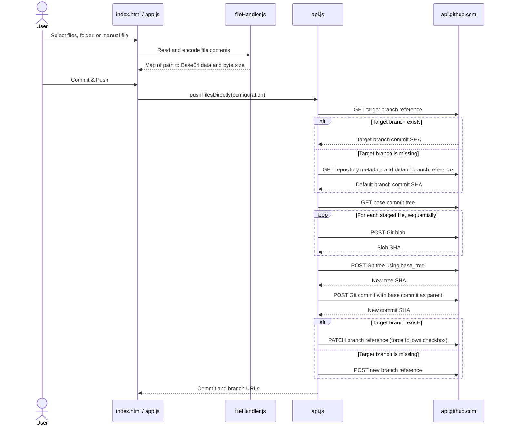

# GitHub Direct Pusher

> Push multiple files and nested folders—including `.github/workflows`—to a GitHub branch in one commit, directly from your browser using GitHub's Git Data API.

[](LICENSE)


GitHub Direct Pusher is a static, client-side single-page application (SPA). It reads files in your browser, creates Git blobs, a tree, and a commit through GitHub's REST API, then updates or creates the selected branch reference. It does not require a backend service or a local Git checkout of the target repository.

> [!NOTE]
> This repository does not include a package manifest, automated build, test workflow, or coverage instrumentation. Accordingly, no release, build-status, or coverage badge is shown.

## Table of Contents

- [Features](#features)
- [Tech Stack & Architecture](#tech-stack--architecture)
  - [Project Structure](#project-structure)
  - [Architecture and Data Flow](#architecture-and-data-flow)
  - [Design Decisions and Limitations](#design-decisions-and-limitations)
- [Getting Started](#getting-started)
  - [Prerequisites](#prerequisites)
  - [Installation and Local Run](#installation-and-local-run)
  - [Troubleshooting](#troubleshooting)
- [Testing](#testing)
- [Deployment](#deployment)
- [Usage](#usage)
  - [Basic Browser Workflow](#basic-browser-workflow)
  - [Manual File Example](#manual-file-example)
- [Configuration](#configuration)
- [License](#license)
- [Contacts & Community Support](#contacts--community-support)
  - [Support the Project](#support-the-project)

## Features

- **Browser-only operation:** files are read in the browser and requests are sent directly to `https://api.github.com`; the project does not provide or require an application server.
- **Multi-file commits:** stage multiple files and publish them together as a single Git commit.
- **Nested directory support:** select a folder or drag and drop nested folders; relative paths are retained, including paths under `.github/`.
- **Manual file creation:** enter a repository-relative path and paste text content, which is useful for creating workflow files or small configuration files.
- **Flexible repository input:** enter `owner/repository` or a GitHub repository URL.
- **Default-branch detection:** query repository metadata and fill in the repository's default branch with **Check Repo**.
- **Configurable target branch:** push to an existing branch or create a new branch based on the repository's default branch when the requested branch does not exist.
- **Custom commit messages:** supply a message for the commit; an application default is used when the field is blank.
- **Optional force update:** opt in to sending `force: true` when updating an existing branch reference. This is disabled by default.
- **Staging controls:** review sorted staged paths and file sizes, remove individual files, or clear the staging list before pushing.
- **Progress and result links:** follow the API workflow in the activity log and open the resulting commit or branch on GitHub.
- **Lightweight static deployment:** the app uses native browser modules and can be served from GitHub Pages or another static-file host without a compile step.

> [!IMPORTANT]
> This tool commits directly to the selected branch. It does not open a pull request, provide a diff review, or bypass repository rules. Verify the repository, branch, and staged paths before committing.

## Tech Stack & Architecture

### Technology Stack

| Area | Implementation | Notes |
| --- | --- | --- |
| User interface | HTML5 and CSS | `index.html` contains the UI; `css/styles.css` supplies custom scrollbar and drop-zone styles. |
| Application code | Native JavaScript ES modules | No framework, package manager, bundler, or transpilation step is used. |
| Utility styling | Tailwind CSS loaded from `https://cdn.tailwindcss.com` | Loaded at runtime by the page; styling therefore depends on access to the CDN. |
| Browser capabilities | Fetch, File API, `FileReader`, `TextEncoder`, `localStorage`, and drag-and-drop APIs | File and folder selection is handled in the browser. |
| Git operations | GitHub REST API and Git Database API | Requests use API version `2022-11-28` and authenticated Bearer-token headers. |
| Runtime services | GitHub API plus a static web host | There is no project-owned backend or database. |

### Project Structure

```text
git-direct-pusher/
├── index.html          # Single-page UI and Tailwind CDN reference
├── css/
│   └── styles.css      # Custom scrollbar and drop-zone styles
├── js/
│   ├── app.js          # UI state, localStorage settings, event handlers, activity log
│   ├── api.js          # Repository parsing and GitHub REST/Git Data API operations
│   └── fileHandler.js  # File/folder traversal and Base64 encoding helpers
├── LICENSE             # Apache License 2.0
└── README.md           # Project documentation
```

### Architecture and Data Flow

The browser stages each file as a repository-relative path and a Base64 payload. The API module then creates the Git objects and moves the branch reference only after the commit has been created.



### Design Decisions and Limitations

- **Git Database API:** each staged file becomes a blob; the blobs are combined into a tree, then one commit is created. This is how the application groups multiple file changes into one commit.
- **Existing files are preserved:** the new tree is based on the current tree (`base_tree`). Paths uploaded with the same names replace their existing entries; other tracked paths remain in the tree.
- **Missing branches use the default branch as a base:** the app queries repository metadata and the default branch reference, creates the commit with that commit as its parent, then creates the requested branch.
- **Direct ref update:** the tool updates an existing branch or creates a new reference; it does not create a pull request. Branch protection rules, rulesets, and token permissions still apply.
- **Sequential uploads:** Git blobs are created one at a time. Large batches can use significant browser memory and may take time or encounter GitHub API limits; the app does not implement batching, retries, or backoff.
- **Regular-file mode:** uploaded tree entries use mode `100644`. Executable permissions, symbolic links, and other filesystem metadata are not preserved.
- **No deletion operation:** the UI stages additions and replacements; it does not remove existing repository files. Empty directories are not represented in Git unless they contain a file.
- **Staging is in memory:** staged file contents are not persisted across a page reload. Only selected settings are saved in browser `localStorage`.

> [!WARNING]
> The optional force-update setting can move an existing branch reference to a non-fast-forward commit and may discard commits from the branch tip. Leave it disabled unless you understand the history impact and are authorized to rewrite that branch.

## Getting Started

### Prerequisites

- A modern browser with JavaScript ES-module, Fetch, File API, and `localStorage` support. A Chromium-based browser is recommended for recursive folder drag-and-drop and folder selection because those features use browser-specific directory APIs.
- A GitHub account with permission to write to the target repository.
- A GitHub Personal Access Token (PAT) with the permissions described below.
- Git to clone the source repository.
- Python 3 is optional and used only to serve the files locally. Node.js is **not** required to run the application.
- Network access to `api.github.com` and `cdn.tailwindcss.com` for GitHub operations and the current CDN-based styling.

For a classic PAT, grant the `repo` scope for repository access. Add the `workflow` scope if the push will create or update files under `.github/workflows/`.

For a fine-grained PAT, select the target repository and grant **Contents: Read and write**. Grant **Workflows: Read and write** when changing workflow files under `.github/workflows/`.

> [!CAUTION]
> The PAT is stored in the browser's `localStorage` and is not encrypted by this application. Use a trusted copy of the app, grant only the permissions required for the target repository, and do not use a token you would not trust to expose to scripts running on the same page.

### Installation and Local Run

Clone the repository and start a local static HTTP server from its root:

```bash
git clone https://github.com/assembly-automation-hub/git-direct-pusher.git
cd git-direct-pusher
python3 -m http.server 8000 --bind 127.0.0.1
```

Open [http://127.0.0.1:8000](http://127.0.0.1:8000) in your browser. Keep the server running while using the page; press `Ctrl+C` in the terminal to stop it. The application has no dependency-install or build command.

> [!TIP]
> Serve the project over HTTP rather than opening `index.html` directly with a `file://` URL. Browsers restrict ES-module loading from local files, so a local static server avoids module-origin errors.

<details>
<summary>Troubleshooting and alternative local serving</summary>

- **The page is blank or modules fail to load:** confirm that the server is running from the repository root and open the HTTP URL, not a `file://` path. Check the browser console for the specific module error.
- **The layout is unstyled:** the page loads Tailwind CSS from `cdn.tailwindcss.com`. Check network access to that host; the small custom stylesheet does not replace the Tailwind utility classes used by the UI.
- **GitHub returns 401 or 403:** confirm the token is valid, has access to the selected repository, and has the necessary `Contents` and (when applicable) `Workflows` write permissions. Organization SSO requirements and branch rules can also affect authorization.
- **GitHub returns 404:** recheck the owner and repository name, branch, and token access. Private repositories may appear unavailable when the token cannot access them.
- **Folder paths are missing or a dropped folder is not traversed:** use a browser with support for the directory APIs used by the page, or choose the files individually. The standard file input and the folder input are separate controls.
- **Remove a saved token:** in browser developer tools, open the storage view for the current site and delete the `gh_direct_token` local-storage entry. If the token may have been exposed, revoke it in GitHub as well. Clearing browser site data also removes the saved repository and branch settings.
- **Alternative server:** any static web server that serves the repository root and supports JavaScript modules can be used instead of Python. No source build is required.

</details>

## Testing

There is currently no automated unit-test or integration-test suite, linter configuration, `package.json`, or CI test workflow in this repository. Commands such as `npm test`, `npm run lint`, or `pytest` are therefore not defined by the project.

The following optional checks can be run from the repository root:

```bash
# Parse each JavaScript file as an ES module (requires Node.js; not needed to run the app).
for file in js/*.js; do
  node --input-type=module --check < "$file" || exit 1
done

# Check the current Git diff for whitespace errors.
git diff --check
```

These commands provide syntax and whitespace checks only; they do not exercise browser behavior or make GitHub API requests.

### Manual Browser Smoke Test

Use a disposable test repository and a temporary branch, not a production branch, for an end-to-end check:

1. Serve the app locally using the instructions above and open it in a supported browser.
2. Enter a least-privilege token and a test repository, then select **Check Repo**. Confirm that the repository is recognized and its default branch is displayed.
3. Stage one file, then stage a nested folder. Confirm the paths, count, and sizes in the staged-file list; try removing one file and clearing the list.
4. Optionally stage a small manual file such as `.github/workflows/smoke-test.yml` in a repository where the token has workflow permissions.
5. Set a disposable target branch and commit message. Keep force update disabled, then select **Commit & Push Directly to Branch**.
6. Follow the commit and branch links in the activity log and verify that all staged paths appear in one commit while unrelated repository files remain unchanged.
7. If testing automatic branch creation, enter a branch name that does not exist and verify that the new branch is based on the repository's default branch.

## Deployment

GitHub Direct Pusher is a static site: deploy the repository's root files as-is. There is no `npm install`, compilation, asset bundling, or server-side runtime.

### Deploy with GitHub Pages

1. Push the project files to a GitHub repository.
2. Open the repository's **Settings → Pages** page.
3. Under **Build and deployment**, select **Deploy from a branch**.
4. Choose the branch containing the site (for example, `main`) and select `/(root)` as the folder, then save.
5. Wait for the Pages deployment to complete and open the published URL, typically `https://OWNER.github.io/REPOSITORY/`.
6. Confirm the application loads over HTTPS and that the relative `css/` and `js/` assets resolve at the published URL.

The repository does not include a CI/CD workflow. If you use an Actions-based Pages deployment, publish the static site files from the repository root as the artifact; no project build step is needed. Docker or Docker Compose is unnecessary for the application itself.

> [!IMPORTANT]
> A static deployment ships the client-side application to every visitor; it cannot keep a PAT secret on the server. The PAT is entered by the user in the browser and sent as an authorization header directly to GitHub. Deploy only a reviewed copy over HTTPS, and keep the external Tailwind CDN dependency in mind when evaluating availability and supply-chain requirements.

For another static host, publish `index.html`, `css/`, and `js/` while retaining their relative paths. The host must serve JavaScript modules with a JavaScript MIME type and support HTTPS for production use.

## Usage

### Basic Browser Workflow

1. Open the deployed page or run the local server described in [Getting Started](#getting-started).
2. Paste a GitHub token into **GitHub Token**. The page saves it in browser `localStorage` when the field changes.
3. Enter `OWNER/REPOSITORY` or a GitHub repository URL in **Repository or URL** and select **Check Repo**. This checks repository access and fills **Target Branch** with the repository's default branch.
4. Stage content using **Select Files**, **Select Folder**, or drag and drop. Relative folder paths are retained. Use **Create or Paste File Manually** for a text file that does not exist on disk.
5. Review the staged paths and sizes. Remove individual entries or select **Clear All** to reset the staging list.
6. Set the target branch and commit message. The default branch field starts as `main`; the default commit message is `Direct push via GitHub Web Pusher`.
7. Leave force update unchecked unless a non-fast-forward branch update is intentional. Select **Commit & Push Directly to Branch** and monitor the execution log.
8. When the operation succeeds, open the linked commit or branch to verify the result on GitHub.

> [!WARNING]
> The app does not show a full content diff or require review approval. Confirm every staged path and use a disposable branch for first-time testing. Do not force-update a branch just to work around a rejected push without first understanding the rejection.

### Manual File Example

To create a small documentation file without uploading a local file:

- **File Path:** `docs/hello.md`
- **File Content:**

```markdown
# Hello from GitHub Direct Pusher

This file is staged in the browser and committed with the other staged files.
```

Select **Stage File**. The path is relative to the repository root. If another staged file uses the same path, the latest staged entry replaces the earlier one in the in-memory staging map.

<details>
<summary>Advanced module usage and edge cases</summary>

The following example uses the repository's exported JavaScript modules directly from a browser ES module. These modules are implementation utilities, not a separately versioned or stable public SDK.

```javascript
import { pushFilesDirectly } from './js/api.js';
import { textToBase64 } from './js/fileHandler.js';

export async function publishExample(token) {
  const content = '# Automated update\n';
  const encodedContent = textToBase64(content);
  const filesMap = new Map([
    ['docs/automated-update.md', {
      base64: encodedContent,
      size: new TextEncoder().encode(content).byteLength,
    }],
  ]);

  return pushFilesDirectly({
    owner: 'OWNER',
    repo: 'REPOSITORY',
    branch: 'docs/automation-example',
    commitMessage: 'docs: add automated update',
    filesMap,
    token, // Pass a token at runtime; never hard-code or commit a credential.
    force: false,
    onProgress: (message) => console.info(message),
  });
}
```

The `filesMap` must be a `Map` whose keys are repository-relative paths and whose values contain a Base64-encoded `base64` payload and a byte-count `size`. The example encodes UTF-8 text; binary files should be read from a browser `File` object using the helper in `js/fileHandler.js`.

**Behavior and edge cases:**

- Re-staging the same path replaces its prior staged value; the app does not prompt for a collision.
- The staging list is memory-only. Reloading or closing the page discards staged files.
- Files are uploaded sequentially. Very large files or many files can be slow, consume browser memory, or be rejected by GitHub's repository/API limits.
- The app does not implement retries, rate-limit backoff, conflict resolution, file deletion, or pull-request creation.
- Folder drag-and-drop relies on browser directory-entry APIs. Folder selection relies on `webkitdirectory` and `webkitRelativePath` support.
- All files are written with mode `100644`; executable bits, symbolic links, empty directories, and other filesystem metadata are not preserved.
- If the requested branch is absent, the app bases the new commit on the repository's default branch and then creates the branch. If that operation is not permitted by repository rules or token permissions, the API request fails.
- A push to an existing branch uses the checkbox value for the ref update's `force` parameter. A new branch is created with a new reference; the checkbox does not rewrite an existing branch in that path.

</details>

## Configuration

The application is configured through the browser UI. There are no environment variables, `.env` files, command-line startup flags, JSON/YAML configuration files, or server-side settings.

| Setting | Default | Persistence | Behavior |
| --- | --- | --- | --- |
| GitHub token | Empty | `localStorage` key `gh_direct_token` | Sent as a Bearer token to `api.github.com`; not encrypted by the app. |
| Repository | Empty | `localStorage` key `gh_direct_repo` | Accepts `owner/repository` or a GitHub URL. |
| Target branch | `main` | `localStorage` key `gh_direct_branch` | **Check Repo** replaces it with the repository's default branch. If a target branch is not found during a push, the default branch is used as the new branch's base. |
| Commit message | `Direct push via GitHub Web Pusher` | Not persisted | A blank value falls back to the same default. |
| Force update | Off | Not persisted | When enabled, requests a forced update for an existing branch reference. Use with care. |
| Staged files | Empty | In-memory only | File bytes and paths are discarded on page reload. |

> [!CAUTION]
> Browser `localStorage` is origin-specific but is not a secret store. Any script executing in the page's origin can read values stored there. Use a trusted deployment, avoid embedding a PAT in source code, and revoke a token immediately if you suspect exposure.

<details>
<summary>API, token permissions, and persistence details</summary>

- **API base URL:** `https://api.github.com` (fixed in `js/api.js`).
- **API version header:** `X-GitHub-Api-Version: 2022-11-28`.
- **Authentication header:** `Authorization: Bearer <token>`.
- **Repository check:** `GET /repos/{owner}/{repo}`.
- **Branch and commit lookup:** Git reference and commit endpoints under `/repos/{owner}/{repo}/git/...`.
- **Object creation:** Git blobs, a Git tree, and a Git commit are created through the Git Database API. The target branch reference is then patched or created.
- **Fine-grained token:** select the target repository and grant **Contents: Read and write**. Grant **Workflows: Read and write** only when the operation needs to modify files in `.github/workflows/`.
- **Classic token:** grant `repo` for repository access and add `workflow` when modifying workflow files.
- **Saved values:** only the token, repository, and target branch are saved in `localStorage`. The commit message, force checkbox, file contents, and activity log are not persisted as settings.
- **Remove saved settings:** delete the relevant `gh_direct_token`, `gh_direct_repo`, and `gh_direct_branch` keys from the browser's storage for the app's origin, or clear that origin's site data. Revoking a token in GitHub is still necessary if it may have been exposed.
- **Styling dependency:** `index.html` loads Tailwind CSS from `cdn.tailwindcss.com` at runtime; it is not installed or bundled with the repository.

</details>

## License

This project is licensed under the [Apache License 2.0](LICENSE). See the `LICENSE` file for the complete terms.

## Contacts & Community Support

## Support the Project

  [](https://devs-in-exile.pages.dev/)
  [](https://www.patreon.com/OstinFCT)
  [](https://ko-fi.com/fctostin)
  [](https://boosty.to/ostinfct)
  [](https://www.youtube.com/@FCT-Ostin)
  [](https://t.me/FCTostin)

  If you find this tool useful, consider leaving a star on GitHub or supporting the author directly.
