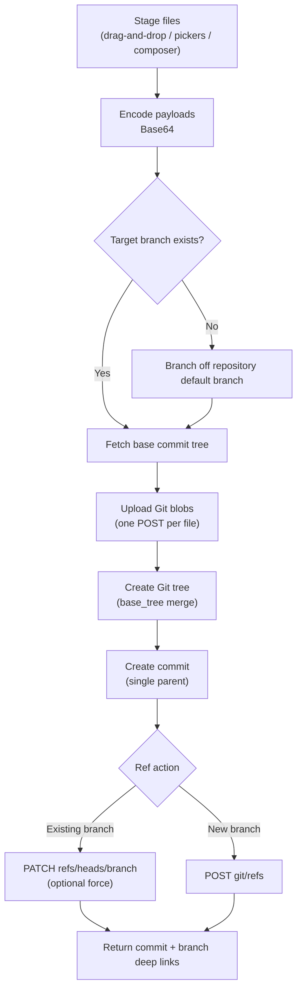
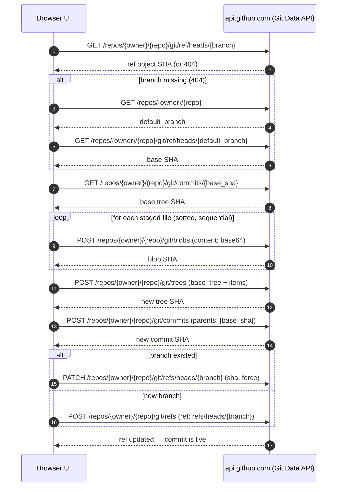

# GitHub Direct Pusher

[](https://assembly-automation-hub.github.io/git-direct-pusher/)
[](https://github.com/assembly-automation-hub/git-direct-pusher)
[-success?style=for-the-badge)](#tech-stack--architecture)
[](#testing)
[](LICENSE)
[](#tech-stack)

**A zero-dependency, 100% client-side Single Page Application that pushes multiple files and nested folders — including `.github/workflows/` — directly to any target branch in one atomic commit via the GitHub Git Data API, with no local clone required.**

**GitHub Direct Pusher** runs entirely in your browser (hosted on GitHub Pages): stage files by drag-and-drop, folder picker, or inline editor, then create blobs, a merged tree, a commit, and a ref update against `https://api.github.com` — all with your own Personal Access Token, which never touches a third-party server.

> [!NOTE]
> This is a **browser-only tool**: there is no backend, no build step, and no `npm install`. The GitHub token you provide is stored exclusively in your browser's `localStorage` and is sent only to `https://api.github.com`. Nothing is proxied through any intermediate server.

---

## Table of Contents

- [Features](#features)
- [Tech Stack & Architecture](#tech-stack--architecture)
  - [Tech Stack](#tech-stack)
  - [Project Structure](#project-structure)
  - [Key Design Decisions](#key-design-decisions)
- [Getting Started](#getting-started)
  - [Prerequisites](#prerequisites)
  - [Installation](#installation)
- [Testing](#testing)
- [Deployment](#deployment)
  - [Deploying to GitHub Pages](#deploying-to-github-pages)
  - [Automating Deploys with GitHub Actions](#automating-deploys-with-github-actions)
  - [Alternative Static Hosts & Containers](#alternative-static-hosts--containers)
- [Usage](#usage)
  - [Basic Usage](#basic-usage)
  - [Programmatic API Usage](#programmatic-api-usage)
- [Configuration](#configuration)
  - [UI Configuration](#ui-configuration)
  - [Persisted Settings (localStorage)](#persisted-settings-localstorage)
  - [Token Permissions](#token-permissions)
- [License](#license)
- [Support the Project](#support-the-project)

---

## Features

### Push Engine

- **Atomic, single-commit pushes** — every staged file lands in exactly one commit on the target branch.
- **Git Data API pipeline** — blobs → tree → commit → ref, orchestrated fully client-side (no `git` binary, no SSH keys, no local working tree).
- **Non-destructive tree merging** — new trees are built on top of `base_tree`, so files that were not staged remain untouched in the repository.
- **Automatic branch bootstrapping** — if the target branch does not exist, it is created from the repository's default branch in the same run.
- **Opt-in force ref update** — a `force: true` ref patch for non-fast-forward situations, gated behind an explicit checkbox.
- **Workflow-file delivery** — push `.github/workflows/*.yml` and other dot-directories that typical web uploaders refuse to touch (requires the `workflow` token scope).

### File Staging

- **Drag & drop of files and entire nested folders**, with full relative directory structure preserved (`webkitGetAsEntry` recursive traversal).
- **Folder picker** (`webkitdirectory`) and **multi-file picker** for browsers/users who prefer native dialogs.
- **Manual inline file composer** — create text files (e.g. `.github/workflows/deploy.yml`) from path + content without leaving the tab.
- **Binary-safe encoding** — all payloads are Base64-encoded Git blobs; UTF-8 text is encoded via `TextEncoder` so non-ASCII content survives round-trips.
- **Staging manager** — sorted file list with per-file byte size, individual `Remove` actions, and `Clear All`.
- **Large-folder resilience** — works around Chrome's 100-entry `FileSystemDirectoryReader` batch limit with a drain loop.

### UX & Productivity

- **Real-time execution log** with timestamps, per-file upload progress (`[3/7] Uploading blob: ...`), and clickable commit/branch deep links on completion.
- **Repository auto-detection** — the *Check Repo* button validates `owner/repo` (or a full GitHub URL) and auto-fills the default branch.
- **Flexible repository input** — accepts `owner/repo`, `https://github.com/owner/repo`, and trailing `.git` suffixes.
- **Persistent workspace** — token, repository, and target branch survive page reloads via `localStorage`.
- **Responsive, dark-themed UI** built with Tailwind CSS, including custom scrollbars and drop-zone state indicators.

### Security & Deployment

- **Zero attack surface on the server side** — there is no server. The token exists only in your browser storage and outbound calls to `api.github.com`.
- **Deploy anywhere static** — GitHub Pages, Netlify, Vercel, nginx, or `python3 -m http.server`.
- **Zero runtime dependencies and no toolchain** — plain ES modules; open the folder and it works.

> [!IMPORTANT]
> Because the app runs client-side, **you are responsible for the token you paste**. Use a Fine-Grained PAT scoped to the single target repository with only *Contents: Read and write* (plus *Workflows: Read and write* if you push CI files). Never paste an organization-wide classic `repo` token on a shared or untrusted machine.

---

## Tech Stack & Architecture

### Tech Stack

| Layer | Technology | Purpose |
| :-- | :-- | :-- |
| Language | Vanilla JavaScript (ES2022, native ES modules) | Application logic, no transpiler/bundler |
| UI | HTML5 + Tailwind CSS (CDN) | Responsive layout, dark theme, utility styling |
| Styling extras | `css/styles.css` | Custom scrollbars, drag-over drop-zone state |
| Persistence | `window.localStorage` | Survives reloads: token, repo, branch |
| File I/O | `FileReader`, `TextEncoder`, `btoa`, `DataTransferItem.webkitGetAsEntry`, `webkitdirectory` | Staging, UTF-8/Base64 encoding, recursive folder traversal |
| Network | `fetch` + GitHub REST / Git Data API (`X-GitHub-Api-Version: 2022-11-28`) | Blobs, trees, commits, refs, repository metadata |
| Hosting | Static hosting (GitHub Pages by default) | The entire product is static files |

### Project Structure

```text
git-direct-pusher/
├── index.html          # Main application UI (Tailwind via CDN)
├── css/
│   └── styles.css      # Custom scrollbars and dropzone indicators
├── js/
│   ├── app.js          # UI state, localStorage persistence, event listeners
│   ├── api.js          # GitHub REST & Git Data API client (blobs, trees, commits, refs)
│   └── fileHandler.js  # Recursive directory & file reader (Base64 conversion)
├── LICENSE             # Apache License 2.0
└── README.md           # Documentation
```

**Module API surface** (each file is a dependency-free ES module, importable on its own):

<details>
<summary><strong>Expand: exported functions per module</strong></summary>

| Module | Export | Signature | Responsibility |
| :-- | :-- | :-- | :-- |
| `js/api.js` | `parseRepoInput` | `(input: string) → {owner, repo} \| null` | Parses `owner/repo` or a full GitHub URL (tolerates `.git` and trailing slashes) |
| `js/api.js` | `ghRequest` | `async (endpoint, token, options?) → any` | Authenticated `fetch` wrapper with GitHub headers and error surfacing |
| `js/api.js` | `getRepoMetadata` | `async (owner, repo, token) → Repo` | `GET /repos/{owner}/{repo}` — used for default-branch detection |
| `js/api.js` | `pushFilesDirectly` | `async ({owner, repo, branch, commitMessage, filesMap, token, force?, onProgress?}) → {commitSha, commitUrl, branchUrl}` | Full push pipeline: ref → blobs → tree → commit → ref update/create |
| `js/fileHandler.js` | `fileToBase64` | `(file: File) → Promise<string>` | Reads a `File` as a Base64 payload via `FileReader.readAsDataURL` |
| `js/fileHandler.js` | `textToBase64` | `(text: string) → string` | UTF-8-safe string → Base64 (`TextEncoder` + `btoa`) |
| `js/fileHandler.js` | `traverseEntry` | `async (entry, stagedFilesMap, currentPath?) → void` | Recursive drag-and-drop traversal (files + nested directories) |
| `js/fileHandler.js` | `processFileList` | `async (fileList, stagedFilesMap) → void` | Normalizes `<input type="file">` / `webkitdirectory` selections into the staging map |

</details>

### Key Design Decisions

1. **100% client-side trust model.** The app is static files; the user's PAT lives only in `localStorage` and is attached exclusively to requests to `api.github.com`. There is no middleman server to compromise — and correspondingly, no server-side logging or token vault.
2. **Atomicity over incremental pushes.** All staged files are uploaded as blobs first, then committed together as one tree/commit/ref move. A failure mid-run leaves the branch pointer unmodified.
3. **Non-destructive `base_tree` merges.** New trees reference the current tip's `base_tree`, so only staged paths change; every other file in the repository is preserved implicitly.
4. **Sequential blob uploads with progress.** Files are uploaded one-by-one in deterministic (sorted) order so the execution log stays readable and rate limits are easier to manage than with burst parallelism.
5. **Map-based staging (`path → {base64, size}`).** A `Map` keyed by relative path gives deterministic deduplication (last write wins), O(1) removals, and sorted rendering for free.
6. **No build step, ever.** Native ES modules + Tailwind CDN keep the repository auditable and instantly deployable; `index.html` *is* the artifact.
7. **Explicit force semantics.** Non-fast-forward ref updates require a deliberate opt-in (`force: true` checkbox), matching Git's own safety defaults.

**Push pipeline at a glance:**



<details>
<summary><strong>Deep dive: Git Data API request sequence and endpoint matrix</strong></summary>



| Step | Method & Endpoint | Payload / Notes |
| :-- | :-- | :-- |
| 1 | `GET /repos/{owner}/{repo}/git/ref/heads/{branch}` | Resolves the tip SHA of the target branch; 404 triggers default-branch fallback |
| 2 | `GET /repos/{owner}/{repo}` | Repository metadata (`default_branch`) for branch bootstrapping / *Check Repo* |
| 3 | `GET /repos/{owner}/{repo}/git/commits/{sha}` | Retrieves the base commit's `tree.sha` for `base_tree` |
| 4 | `POST /repos/{owner}/{repo}/git/blobs` | `{ content, encoding: "base64" }` per staged file |
| 5 | `POST /repos/{owner}/{repo}/git/trees` | `{ base_tree, tree: [{ path, mode: "100644", type: "blob", sha }] }` |
| 6 | `POST /repos/{owner}/{repo}/git/commits` | `{ message, tree, parents: [baseSha] }` |
| 7 | `PATCH /repos/{owner}/{repo}/git/refs/heads/{branch}` | `{ sha, force }` — updates an existing branch |
| 7′ | `POST /repos/{owner}/{repo}/git/refs` | `{ ref: "refs/heads/{branch}", sha }` — creates a missing branch |

All requests carry the headers `Authorization: Bearer <token>`, `Accept: application/vnd.github+json`, and `X-GitHub-Api-Version: 2022-11-28`. File mode is fixed to `100644` (regular, non-executable blob).

</details>

---

## Getting Started

### Prerequisites

- **A modern browser** — recent Chrome, Edge, Firefox, or Safari. Chromium-based browsers offer the most complete drag-and-drop *folder* experience (`webkitGetAsEntry`); the folder picker (`webkitdirectory`) works in all current major browsers.
- **A GitHub account** and a **Personal Access Token** with permissions to push to the target repository (see [Token Permissions](#token-permissions)).
- **For local development only** — one of the following to serve static files over HTTP:
  - Python 3.8+ (`python3 -m http.server`), or
  - Node.js 18+ (`npx serve`), or any other static file server.

> [!WARNING]
> The app **must be served over `http://` or `https://`**. Native ES modules (`<script type="module">`) are blocked by the browser's CORS policy on `file://` URLs — double-clicking `index.html` from the file manager will show a blank page with a console error. Use a local static server (below) or the hosted GitHub Pages instance.

### Installation

```bash
# 1. Clone the repository
git clone https://github.com/assembly-automation-hub/git-direct-pusher.git
cd git-direct-pusher

# 2. Serve the app locally (pick one)
python3 -m http.server 8080
# — or —
npx serve .

# 3. Open the app
#    http://localhost:8080   (python http.server)
#    http://localhost:3000   (npx serve)
```

No dependency installation, no compilation: `index.html` is the complete shippable artifact.

<details>
<summary><strong>Troubleshooting & alternative installation methods</strong></summary>

| Symptom | Cause | Resolution |
| :-- | :-- | :-- |
| Blank page, console error `Cross-origin requests are only supported for protocol schemes: http, data...` | Opened via `file://` | Serve over HTTP: `python3 -m http.server 8080` or `npx serve .` |
| `GitHub API Error (401): Bad credentials` | Wrong/expired/typo'd token | Create a new PAT; re-paste — the value is saved on `change`, so blur the field to persist |
| `GitHub API Error (403)` when pushing `.github/workflows/*` | Missing `workflow` scope (classic) or *Workflows* permission (fine-grained) | See [Token Permissions](#token-permissions) |
| Dragging a folder does nothing | Browser lacks `webkitGetAsEntry` (or an extension intercepts drag events) | Use the **Select Folder** button instead, or try a Chromium-based browser |
| "Branch not found" and an unexpected base commit | Target branch genuinely missing | Intended: the tool branches off the repo default and tells you in the log (`Using default branch ... as base`) |
| Tailwind styles missing | `cdn.tailwindcss.com` unreachable (offline / blocking extension) | Restore network access or allow-list the CDN |

#### Alternative install methods

- **Zero-install hosted instance** — open the published app: <https://assembly-automation-hub.github.io/git-direct-pusher/>.
- **Download ZIP** — *Code → Download ZIP* on GitHub, extract, then serve the folder with any static server (no `git` required).
- **Fork-and-deploy** — fork the repository and enable GitHub Pages on your fork to get a private-ish copy under your account.

</details>

---

## Testing

This project ships **zero runtime dependencies**, so there is no bundled unit/integration test framework (there is nothing to `npm install`). Verification is a layered workflow of **static checks**, a **documentation lint**, a **local smoke test**, and a **manual regression matrix** against a scratch repository.

**1. Module syntax checks (fast, no network):**

```bash
node --check js/api.js && node --check js/app.js && node --check js/fileHandler.js
```

**2. HTML validation (linter):**

```bash
npx --yes html-validate index.html
```

**3. Formatting check (optional linter for style drift):**

```bash
npx --yes prettier --check "js/**/*.js" "css/**/*.css" "index.html"
# Apply formatting (contributor convenience — not required to run the app):
npx --yes prettier --write "js/**/*.js" "css/**/*.css" "index.html"
```

**4. Documentation lint (Markdown):**

```bash
npx --yes markdownlint-cli2 README.md
```

Rules are tuned in [`.markdownlint.json`](.markdownlint.json): line-length (`MD013`) is disabled so tables and badge rows render naturally, and inline HTML (`MD033`) is allow-listed to the `<details>` / `<summary>` / `<strong>` elements this documentation intentionally uses.

**5. Local integration smoke test:**

```bash
python3 -m http.server 8080 &      # boot the static server in the background
curl -s -o /dev/null -w "%{http_code}\n" http://localhost:8080/          # expect: 200
curl -s -o /dev/null -w "%{http_code}\n" http://localhost:8080/js/app.js # expect: 200
curl -s http://localhost:8080/ | grep -o '<title>[^<]*</title>'          # expect: <title>GitHub Direct Pusher</title>
```

**6. End-to-end regression matrix** — run against a throwaway repository with a scoped PAT:

<details>
<summary><strong>Expand: manual QA / regression checklist</strong></summary>

| # | Scenario | Steps | Expected result |
| :-- | :-- | :-- | :-- |
| 1 | Happy path — single file | Stage `hello.txt`, push to `main` | One commit; file appears on the branch; log shows commit link |
| 2 | Nested folders | Drag a folder tree containing `src/`, `.github/workflows/ci.yml` | Relative paths preserved exactly (including dot-dirs) |
| 3 | Large folder (>100 entries) | Drag a directory with 150+ files on Chrome | All files staged (batch-reader drain loop works) |
| 4 | Missing branch bootstrapping | Push to a branch name that does not exist | Branch is created from default; log announces the base |
| 5 | Non-destructive merge | Push one file to a populated repo | Only that path changes; all other files intact |
| 6 | Force ref update | Commit locally-based divergence, enable *force*, push | Ref moves to the new commit (`force: true`) |
| 7 | Invalid token | Push with a revoked PAT | Red error line: `GitHub API Error (401)`; button re-enabled |
| 8 | Missing workflow scope | Push `.github/workflows/deploy.yml` with a Contents-only token | `403` surfaced in the log with API message |
| 9 | Empty staging | Click *Commit & Push* with 0 files | Client-side alert asking to stage at least one file |
| 10 | Manual composer | Stage `.github/workflows/deploy.yml` via the inline editor | UTF-8 content round-trips; YAML intact on GitHub |
| 11 | Duplicate paths | Stage the same relative path twice | Last write wins (Map semantics); single entry listed |
| 12 | Binary payload | Push a small `.png` | File byte-identical after clone (Base64 blob) |
| 13 | Reload persistence | Fill token/repo/branch, reload | Fields restored from `localStorage` |
| 14 | URL parsing | Use `https://github.com/owner/repo.git/` in the repo field | Parsed to `owner/repo`; *Check Repo* confirms |

</details>

<details>
<summary><strong>Optional: wire these commands into npm scripts</strong></summary>

Drop this minimal `package.json` into the repo root if you prefer `npm test` / `npm run lint` ergonomics (it does not change how the app runs):

```json
{
  "name": "git-direct-pusher",
  "version": "1.0.0",
  "private": true,
  "type": "module",
  "scripts": {
    "serve": "python3 -m http.server 8080",
    "lint:js": "node --check js/api.js && node --check js/app.js && node --check js/fileHandler.js",
    "lint:html": "html-validate index.html",
    "lint:md": "markdownlint-cli2 README.md",
    "lint": "npm run lint:js && npm run lint:html && npm run lint:md",
    "test": "npm run lint"
  },
  "devDependencies": {
    "html-validate": "^11.0.0",
    "markdownlint-cli2": "^0.23.0",
    "prettier": "^3.0.0"
  }
}
```

With that in place you get the conventional entry points: `npm test` (runs every static check), `npm run lint`, `npm run lint:js`, `npm run lint:html`, `npm run lint:md`, and `npm run serve`.

For a stricter JS lint pass, add ESLint 9 with a flat config:

```js
// eslint.config.js
export default [
  {
    files: ['js/**/*.js'],
    languageOptions: {
      ecmaVersion: 2022,
      sourceType: 'module',
      globals: { window: 'readonly', document: 'readonly', localStorage: 'readonly', fetch: 'readonly', alert: 'readonly', FileReader: 'readonly', TextEncoder: 'readonly', btoa: 'readonly' }
    },
    rules: { 'no-unused-vars': 'error', 'no-undef': 'error', 'no-var': 'error', 'prefer-const': 'error' }
  }
];
```

```bash
npx --yes eslint js/          # after adding eslint.config.js
```

</details>

> [!TIP]
> When testing pushes, always use a **scratch repository** and a token scoped to it. It is the cheapest insurance against a force-push mis-click on something you care about.

---

## Deployment

Being a pure static SPA, "deploying" **GitHub Direct Pusher** means copying three static paths (`index.html`, `css/`, `js/`) to any web server. The canonical deployment target is **GitHub Pages**.

### Deploying to GitHub Pages

1. Create a new repository on GitHub and push these files to the `main` branch.
2. Go to **Settings → Pages**.
3. Under **Build and deployment**, select **Deploy from a branch** and choose `main` / `/ (root)`.
4. Open your published GitHub Pages URL (for this repository: <https://assembly-automation-hub.github.io/git-direct-pusher/>).

Post-deploy checklist:

- [ ] The page loads with Tailwind styling applied (dark slate theme).
- [ ] `js/app.js` loads without console errors (Network tab: `200`, type `module`).
- [ ] Drag-and-drop staging works on the published origin (HTTPS).
- [ ] A test push to a scratch repository succeeds and the commit link opens on github.com.

> [!NOTE]
> GitHub Pages serves the app over HTTPS, which satisfies the ES-module and `fetch` requirements out of the box. If you self-host, terminate TLS yourself — browsers treat non-HTTPS origins as non-secure contexts and will block module loading and camera/clipboard-style APIs.

### Automating Deploys with GitHub Actions

<details>
<summary><strong>Expand: CI/CD workflow (lint on PR, deploy to Pages on main)</strong></summary>

Save as `.github/workflows/pages.yml`:

```yaml
name: CI & Deploy to GitHub Pages

on:
  push:
    branches: [main]
  pull_request:
    branches: [main]

permissions:
  contents: read
  pages: write
  id-token: write

jobs:
  validate: # static checks — runs on every PR and push
    runs-on: ubuntu-latest
    steps:
      - uses: actions/checkout@v4
      - uses: actions/setup-node@v4
        with:
          node-version: 22
      - name: Syntax-check all ES modules
        run: |
          node --check js/api.js
          node --check js/app.js
          node --check js/fileHandler.js
      - name: Validate HTML
        run: npx --yes html-validate index.html

  deploy: # publish to GitHub Pages — only on pushes to main
    if: github.event_name == 'push' && github.ref == 'refs/heads/main'
    needs: validate
    runs-on: ubuntu-latest
    environment:
      name: github-pages
      url: ${{ steps.deployment.outputs.page_url }}
    steps:
      - uses: actions/checkout@v4
      - uses: actions/configure-pages@v5
      - uses: actions/upload-pages-artifact@v3
        with:
          path: .
      - id: deployment
        uses: actions/deploy-pages@v4
```

Then switch **Settings → Pages → Source** to **GitHub Actions**. Every green push to `main` is published automatically.

</details>

### Alternative Static Hosts & Containers

Any static host works identically — copy the repo contents (or point the host at the repository):

```bash
# Netlify (drag-and-drop the folder at app.netlify.com/drop, or CLI):
npx --yes netlify-cli deploy --dir . --prod

# Vercel:
npx --yes vercel --prod
```

<details>
<summary><strong>Expand: containerization (nginx + Docker)</strong></summary>

A minimal production image is a stock static-file server:

```dockerfile
# syntax=docker/dockerfile:1
FROM nginx:1.27-alpine
# Ship only the static artifact — no build stage required
COPY index.html /usr/share/nginx/html/index.html
COPY css/       /usr/share/nginx/html/css/
COPY js/        /usr/share/nginx/html/js/
# Optional: force HTTPS at the edge / reverse proxy; nginx here serves plain HTTP
EXPOSE 80
```

```bash
docker build -t git-direct-pusher .
docker run --rm -p 8080:80 git-direct-pusher
# App now on http://localhost:8080
```

Docker Compose equivalent:

```yaml
services:
  git-direct-pusher:
    build: .
    ports:
      - '8080:80'
    restart: unless-stopped
```

</details>

> [!CAUTION]
> If you host a **public copy** of this tool, you become the operator of a page that asks users for GitHub tokens. The application never sends tokens anywhere except `api.github.com`, but users must trust *your* deployment (anyone can modify published JavaScript). For personal use, prefer your own fork/Pages instance; for shared use, publish your deployment's source and commit hashes openly.

---

## Usage

### Basic Usage

1. **Create a token** with the required scopes ([Token Permissions](#token-permissions)).
2. **Paste the GitHub Token** into the first field (`ghp_...` or `github_pat_...`). It is masked and persisted on blur.
3. **Enter the target repository** as `owner/repo` or a full GitHub URL, then click **Check Repo** to validate access and auto-fill the default branch (shown in the status line: `Connected: owner/repo (default: main)`).
4. **Set the Target Branch** (defaults to `main`) and an optional **Commit Message** (defaults to `Direct push via GitHub Web Pusher`).
5. **Stage files** using any of the three inputs:
   - drag & drop files or whole folders onto the drop zone,
   - **Select Files** / **Select Folder** buttons,
   - the collapsible **Create or Paste File Manually** composer (path + content) for text files such as `.github/workflows/deploy.yml`.
6. Review the **Staged Files** list (paths + sizes); remove individual entries or **Clear All** as needed.
7. Click **Commit & Push Directly to Branch** and watch the **Execution Log** stream per-file blob uploads, tree/commit creation, and the ref update.
8. Click the green **commit link** or **branch link** in the log to inspect the result on GitHub.

### Programmatic API Usage

The application's core is exposed as dependency-free ES modules (`js/api.js`, `js/fileHandler.js`), importable from any browser context. This is exactly what the UI's push button executes under the hood:

```js
// Import the same modules the UI uses — no build step, works in any browser context.
import { parseRepoInput, pushFilesDirectly } from './js/api.js';
import { textToBase64 } from './js/fileHandler.js';

// 1) Parse the repository ("owner/repo" or a full GitHub URL)
const repo = parseRepoInput('assembly-automation-hub/git-direct-pusher');
// → { owner: 'assembly-automation-hub', repo: 'git-direct-pusher' }

// 2) Build the staging map: relative path → { base64, size }
const filesMap = new Map();
const content = 'name: CI\non: [push]\n';
filesMap.set('.github/workflows/ci.yml', {
  base64: textToBase64(content),           // UTF-8-safe Base64 encoding
  size: new TextEncoder().encode(content).byteLength
});

// 3) Execute the atomic push
const result = await pushFilesDirectly({
  owner: repo.owner,
  repo: repo.repo,
  branch: 'main',                          // created automatically if missing
  commitMessage: 'ci: add workflow via API',
  filesMap,
  token: localStorage.getItem('gh_direct_token'),
  force: false,                            // true = non-fast-forward ref update
  onProgress: (msg) => console.log(msg)    // human-readable progress lines
});

console.log(result.commitUrl); // → https://github.com/owner/repo/commit/<sha>
```

<details>
<summary><strong>Advanced Usage — force pushes, dynamic staging, branch bootstrapping, and embedding</strong></summary>

**Force push (non-fast-forward ref moves).** When the local base has diverged from what the remote expects, a plain ref update fails with `422`. The UI exposes this as a checkbox; in code:

```js
await pushFilesDirectly({
  /* ... */
  force: true // PATCH /git/refs/heads/{branch} with { sha, force: true }
});
```

**Staging from arbitrary sources.** Because `filesMap` is a plain `Map`, you can stage from anywhere — ZIP extraction, another API, or in-memory generated files:

```js
import { textToBase64, fileToBase64 } from './js/fileHandler.js';

const filesMap = new Map();

// Generated text file
filesMap.set('README.generated.md', { base64: textToBase64('# Auto\n'), size: 8 });

// A File/Binary picked by the user (e.g. from <input type="file">)
const file = document.querySelector('input[type=file]').files[0];
filesMap.set(file.name, { base64: await fileToBase64(file), size: file.size });
```

**Bootstrapping a brand-new branch.** Nothing to configure — pass `branch: 'feature/x'`; on `404` the pipeline resolves the repository default branch, uses its tip as `baseSha`, and creates `refs/heads/feature/x` at the new commit.

**Embedding in your own UI.** `js/api.js` and `js/fileHandler.js` have zero DOM dependencies and can be dropped into any ES-module page; only `js/app.js` is UI-bound.

</details>

<details>
<summary><strong>Custom Formatters — progress reporting &amp; log output</strong></summary>

The push pipeline reports progress as pre-escaped HTML snippets (paths are wrapped in `<span class="text-blue-300">`) through the `onProgress` callback. The built-in UI logger (`log(message, isError)` in `js/app.js`) prepends a localized timestamp and applies red, bold styling to error lines. Because the sink is a plain callback, you can re-format the stream for any destination — a toast stack, `console`, a telemetry buffer, or a file.

**Plain-text formatter** (strip the emitted markup before logging):

```js
const result = await pushFilesDirectly({
  /* ... */
  onProgress: (msg) => {
    // Strip the HTML the pipeline emits and route plain text to your own logger
    const plain = msg.replace(/<[^>]+>/g, '');
    console.log(`[push] ${plain}`);
  }
});
```

**Structured JSON-lines formatter** (machine-parseable audit trail):

```js
const formatLine = (msg, level = 'info') =>
  JSON.stringify({
    ts: new Date().toISOString(),   // ISO-8601 timestamp
    level,                          // 'info' | 'error'
    event: 'push-progress',
    msg: msg.replace(/<[^>]+>/g, '') // same markup-stripping as above
  });

try {
  await pushFilesDirectly({
    /* ... */
    onProgress: (msg) => myTelemetrySink.write(formatLine(msg) + '\n')
  });
} catch (err) {
  // Failures throw — format them with the same schema for a uniform log
  myTelemetrySink.write(formatLine(err.message, 'error') + '\n');
}
```

**Severity mapping with HTML preserved** (when the sink renders markup, e.g. a styled panel like the built-in log box):

```js
onProgress: (msg) => {
  const line = document.createElement('div');
  line.innerHTML = `<span class="text-slate-500">[${new Date().toLocaleTimeString()}]</span> ${msg}`;
  myLogPanel.appendChild(line); // keeps the blue path highlighting intact
}
```

</details>

<details>
<summary><strong>Edge Cases & Failure Modes</strong></summary>

| Situation | Behavior | Mitigation |
| :-- | :-- | :-- |
| Target branch does not exist | Auto-created from the repository's default branch; logged explicitly | None needed — verify the chosen base in the log |
| Ref update rejected (`422`, non-fast-forward) | The commit exists but the branch pointer does not move | Enable **force update** (understands history rewrite) or re-run on a fresh base |
| Pushing `.github/workflows/*` without the `workflow` scope | `403` with GitHub's explanatory message | Add the scope/permission and retry |
| Empty staging map | Client-side `alert()`; no network calls made | Stage at least one file |
| Duplicate relative paths staged | Last write wins (`Map` semantics) | The staging list shows a single entry; re-add with the desired content |
| Non-ASCII / binary content | Correctly round-tripped (UTF-8 text via `TextEncoder`; binary via `FileReader` Base64) | Verify large binaries via clone, not the web UI |
| Very large files (>50–100 MB) | GitHub rejects or times out blobs; browser memory balloons (Base64 ≈ 4/3 size) | Prefer Git LFS or a local clone for large assets |
| Chrome folders with >100 entries | `FileSystemDirectoryReader` returns batches of 100 | Handled internally by a drain loop (`readAllDirectoryEntries`) |
| GitHub secondary rate limits | Burst pushes of many blobs can hit abuse detection | Reduce file count per run; the sequential uploader keeps requests spaced |
| Token leaked / lost | Token is only in `localStorage`, but readable by any script on that origin | Use fine-grained, repo-scoped, expiring tokens; clear storage when done |
| Two tabs pushing simultaneously | Last ref update wins; one commit becomes an orphan | Close duplicates; one pusher per branch at a time |

</details>

---

## Configuration

**GitHub Direct Pusher** has no `.env`, no config file, and no CLI flags — all runtime configuration is entered in the UI and (for the connection trio) persisted to `localStorage`. Code-level constants are kept in `js/api.js` (`GITHUB_API_BASE = 'https://api.github.com'`, `X-GitHub-Api-Version: 2022-11-28`).

### UI Configuration

| Field | Control | Default | Description |
| :-- | :-- | :-- | :-- |
| GitHub Token | `<input type="password">` | *(empty)* | PAT used as `Authorization: Bearer` for every API call |
| Repository or URL | text + **Check Repo** | *(empty)* | `owner/repo` or full GitHub URL; *Check Repo* validates and fills the default branch |
| Target Branch | text | `main` | Branch to update (auto-created from the default branch if missing) |
| Commit Message | text | `Direct push via GitHub Web Pusher` | Message of the single generated commit |
| Force update branch reference | checkbox | *unchecked* | Sends `force: true` on the ref PATCH (non-fast-forward moves) |
| Manual composer (collapsible) | path + textarea | — | Stage a text file inline (e.g. `.github/workflows/deploy.yml`) |

### Persisted Settings (localStorage)

| Key | Written when | Value |
| :-- | :-- | :-- |
| `gh_direct_token` | Token field `change` (blur) | The PAT, verbatim |
| `gh_direct_repo` | Repo field `change` (blur) | Repository string as typed |
| `gh_direct_branch` | Branch field `change`, or after *Check Repo* | Target branch name |

Clear any key from DevTools → *Application → Local Storage*, or simply overwrite the field. The commit message and force flag are **not** persisted.

> [!TIP]
> On shared machines, run the app in a private window or clear `gh_direct_token` after use. A fine-grained token scoped to one repository, with a short expiry, limits the blast radius even if storage leaks.

### Token Permissions

| Token type | Required permissions |
| :-- | :-- |
| **Personal Access Token (Classic)** | `repo` (full control of private and public repositories), `workflow` (required if pushing files inside `.github/workflows/`) |
| **Fine-Grained Personal Access Token** | **Contents:** Read and Write, **Workflows:** Read and Write — restricted to the single target repository |

<details>
<summary><strong>Full configuration reference — defaults, request headers, and endpoint constants</strong></summary>

Default client state (as persisted/restored by `js/app.js`):

```json
{
  "gh_direct_token": "",
  "gh_direct_repo": "",
  "gh_direct_branch": "main"
}
```

Effective request defaults applied by `ghRequest` to every call:

```json
{
  "base_url": "https://api.github.com",
  "headers": {
    "Authorization": "Bearer <token>",
    "Accept": "application/vnd.github+json",
    "X-GitHub-Api-Version": "2022-11-28"
  }
}
```

Tree item schema emitted for every staged file:

```json
{ "path": "<relative/path>", "mode": "100644", "type": "blob", "sha": "<blob_sha>" }
```

Reference update payloads:

```json
// Existing branch (PATCH /repos/{owner}/{repo}/git/refs/heads/{branch})
{ "sha": "<commit_sha>", "force": false }

// New branch (POST /repos/{owner}/{repo}/git/refs)
{ "ref": "refs/heads/<branch>", "sha": "<commit_sha>" }
```

Environment variables and startup flags: **none** (by design). Serve-time conveniences that operators commonly use:

```bash
python3 -m http.server 8080 --bind 0.0.0.0   # expose beyond localhost
npx serve . -l 3000                          # pin the port
```

</details>

---

## License

Licensed under the **Apache License, Version 2.0** (see [`LICENSE`](LICENSE) for the full text).

- You may use, modify, and distribute this software in source or binary form.
- You must include a copy of the license and retain copyright/attribution notices.
- The software is provided "as is", without warranty of any kind.

```text
Copyright 2026 Devs In Exile Studio

Licensed under the Apache License, Version 2.0 (the "License");
you may not use this file except in compliance with the License.
You may obtain a copy of the License at

    http://www.apache.org/licenses/LICENSE-2.0
```

---

## Support the Project

[](https://devs-in-exile.pages.dev/)
[](https://www.patreon.com/OstinFCT)
[](https://ko-fi.com/fctostin)
[](https://boosty.to/ostinfct)
[](https://www.youtube.com/@FCT-Ostin)
[](https://t.me/FCTostin)

If you find this tool useful, consider leaving a star on GitHub or supporting the author directly.
